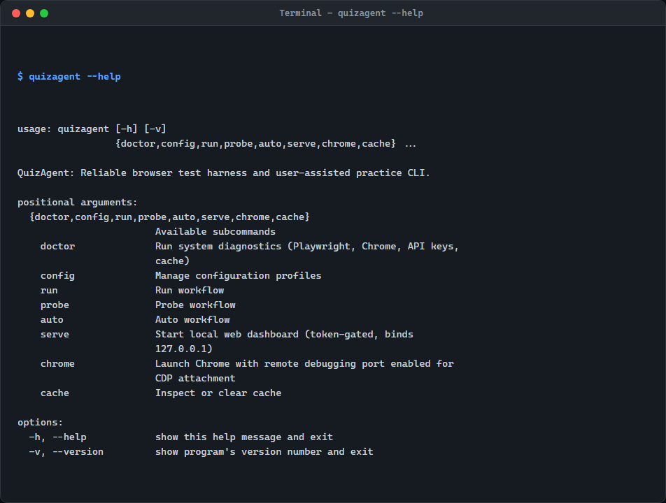
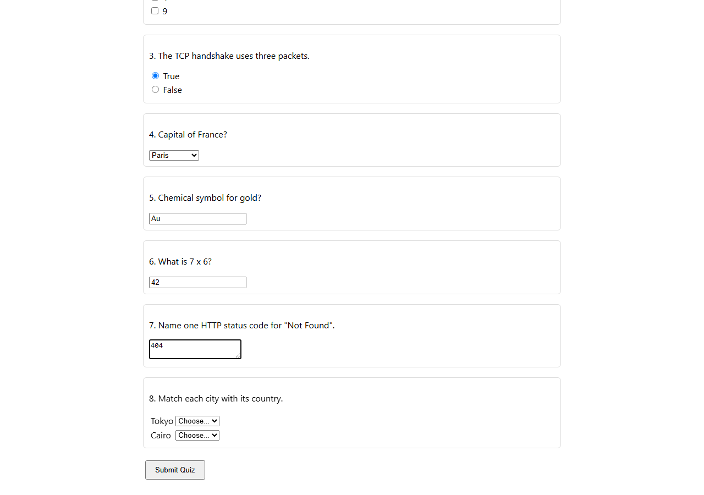
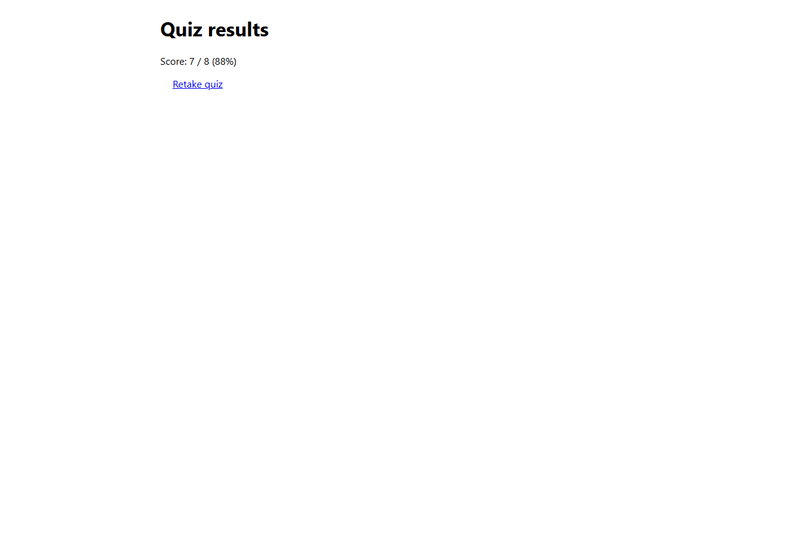

# AssessPilot

[](https://github.com/ram-mangla/assesspilot/actions/workflows/ci.yml)
[](https://github.com/ram-mangla/assesspilot/releases)
[](LICENSE)
[](https://www.python.org/downloads/)
[](https://playwright.dev/)

> **Autonomous, self-learning browser assessment test harness and AI copilot for web evaluations and certification exams.**

AssessPilot drives assessment, evaluation, and test web applications using a real Chromium browser via Playwright (`discover -> scan -> answer -> navigate -> submit -> verify`). Engineered strictly for **authorized practice, self-paced training, and QA/load testing of platforms you own or are explicitly authorized to test**.

*(Note: For backward compatibility, both `assesspilot` and `quizagent` commands are supported identically).*

Answers can originate from an exact **Answer Key file**, an **AI-assisted model chain** (NVIDIA NIM or OpenRouter) with interactive **human-in-the-loop review**, or deterministic **fallback strategies** (first, last, random).

---

## Table of Contents

1. [Features](#features)
2. [Screenshots & Demo](#screenshots--demo)
3. [System Requirements](#system-requirements)
4. [Installation](#installation)
   - [Windows (PowerShell / Command Prompt)](#windows-installation)
   - [Linux (Ubuntu / Debian / Fedora)](#linux-installation)
   - [macOS](#macos-installation)
5. [First-Run Health Check (`doctor`)](#first-run-health-check)
6. [Interactive Guided CLI](#interactive-guided-cli)
7. [Direct CLI Workflows](#direct-cli-workflows)
8. [Authentication Modes](#authentication-modes)
9. [Chrome Profile & Session Management](#chrome-profile--session-management)
10. [Saved Playwright Sessions](#saved-playwright-sessions)
11. [AI Providers & Model Routing](#ai-providers--model-routing)
12. [Adaptive Self-Learning & DOM Evolution](#adaptive-self-learning--dom-evolution)
13. [Configuration Reference (YAML / JSON)](#configuration-reference)
14. [Security & Responsible Use](#security--responsible-use)
15. [Architecture](#architecture)
16. [Troubleshooting & Diagnostics](#troubleshooting--diagnostics)
17. [Development & Automated Testing](#development--automated-testing)
18. [Contributing](#contributing)
19. [Roadmap](#roadmap)
20. [License](#license)

---

## 1. Features

- **Adaptive Self-Learning Engine:** Dynamically mines DOM patterns, question container clusters, button selectors, and Markov state transition graphs as you navigate arbitrary evaluation platforms.
- **Universal DOM Heuristics:** Scans native radio buttons, checkboxes, dropdown selects, text fields, textareas, numeric inputs, ARIA widgets (`role="radio"`, `role="checkbox"`), open Shadow DOM, and iframes.
- **Human-in-the-Loop Review:** Interactive review prompt allows learners to inspect, modify, or reject AI model suggestions before anything is clicked or submitted.
- **Multiple Authentication Methods:** Supports public assessments, credentials via environment variables / masked prompts, persistent Chrome profiles, CDP remote debugging, and saved Playwright storage state files.
- **Dual Execution Engine:**
  - Guided interactive terminal wizard (`assesspilot run`).
  - Direct, scriptable command-line arguments and configuration files.
- **AI Model Routing:** Integrated with OpenAI-compatible APIs (NVIDIA NIM and OpenRouter) with automatic fallback chains (`nemotron_ultra`, `nemotron_lightning`, `nemotron_super_vl`, `north_mini_code`, `gemma_4`).
- **Simulated Pacing Profiles:** Realistic behavior models (`instant`, `student`, `careful`, `erratic`) with reading delays, thinking pauses, answer changes, and revisit probabilities.
- **Verified Metrics Only:** Measures actual DOM facts and server confirmations. Never estimates scores or fabricates success rates.
- **Live Local Control Dashboard:** Built-in token-gated web dashboard (`assesspilot serve`) running strictly on `127.0.0.1`.

---

## 2. Screenshots & Demo

### CLI Command Center & Help Output


### System Diagnostics (`assesspilot doctor`)


### Guided Interactive Wizard


### Assessment DOM Detection


### User-Reviewed Answer Assistance


### Server-Graded Verification Report


---

## 3. System Requirements

- **Operating System:** Windows 10/11 (x64), Linux (Ubuntu 20.04+, Debian 11+, Fedora 36+), macOS 12+ (Intel & Apple Silicon).
- **Python:** Python 3.10, 3.11, 3.12, 3.13, or 3.14.
- **Browser:** Google Chrome (optional, for persistent profile/CDP) or Playwright bundled Chromium.

---

## 4. Installation

### Windows Installation

```powershell
# 1. Clone the repository
git clone https://github.com/ram-mangla/assesspilot.git
cd assesspilot

# 2. Run the automated setup script
.\setup.bat

# Or install manually:
python -m venv .venv
.\.venv\Scripts\Activate.ps1
python -m pip install --upgrade pip
pip install -e .
python -m playwright install chromium
```

### Linux Installation

```bash
# 1. Clone the repository
git clone https://github.com/ram-mangla/assesspilot.git
cd assesspilot

# 2. Run the automated setup script
chmod +x setup.sh
./setup.sh

# Or install manually:
python3 -m venv .venv
source .venv/bin/activate
pip install --upgrade pip
pip install -e .
python -m playwright install chromium
```

### macOS Installation

```bash
# 1. Clone the repository
git clone https://github.com/ram-mangla/assesspilot.git
cd assesspilot

# 2. Run setup script or install via pip
python3 -m venv .venv
source .venv/bin/activate
pip install --upgrade pip
pip install -e .
python -m playwright install chromium
```

Verify your installation:
```bash
assesspilot --version
assesspilot doctor
```

---

## 5. First-Run Health Check (`doctor`)

Before running your first assessment, run the built-in diagnostic tool to verify all requirements:

```bash
assesspilot doctor
```

`assesspilot doctor` verifies:
- Python version and architecture.
- Playwright installation and Chromium browser binary status.
- System Google Chrome executable detection.
- Chrome profile directories and active instance locks.
- CDP remote debugging port reachability.
- AI provider API keys (`NVIDIA_API_KEY`, `OPENROUTER_API_KEY`) with secret masking.
- Filesystem cache read/write permissions.

---

## 6. Interactive Guided CLI

Launch AssessPilot without arguments to enter the guided setup wizard:

```bash
assesspilot run
```

The wizard prompts you through:
1. Target Assessment URL.
2. Browser mode (Headed, Headless, Attach via CDP, Persistent Profile).
3. Authentication mode (None, Credentials, Saved Session).
4. Strategy (AI-Assisted Practice, Answer Key, Fallback Only).
5. AI provider selection (NVIDIA NIM, OpenRouter, Mock) and model choice.
6. Human review mode (Yes / No).
7. Behavioral pacing (Student, Instant, Careful, Erratic).
8. Report output directory.

---

## 7. Direct CLI Workflows

### Direct URL Execution
```bash
assesspilot run "https://assessment.example.edu/exam" --key examples/key_example.json
```

### AI-Assisted Practice with Human Review
```bash
assesspilot run "https://assessment.example.edu/exam" \
  --ai-provider nvidia \
  --ai-model nemotron_ultra \
  --ai-review
```

### Offline / Mock AI Practice
```bash
assesspilot run "https://assessment.example.edu/exam" --mock-ai
```

### Dry Run DOM Inspection (`probe`)
Inspect what AssessPilot's DOM scanner detects without answering or submitting:
```bash
assesspilot probe "https://assessment.example.edu/exam"
```

### Autopilot Discovery & Crawler (`auto`)
Crawl same-origin links to find and take assessment modules:
```bash
assesspilot auto "https://assessment.example.edu/portal" --list
assesspilot auto "https://assessment.example.edu/portal" --pick "networking" --key examples/key_example.json
```

### Cache Management & Self-Learning Inspection
```bash
assesspilot cache show
assesspilot cache clear
```

---

## 8. Authentication Modes

### A. Public / Unauthenticated
Assessments that do not require credentials:
```bash
assesspilot run "https://assessment.example.edu/exam"
```

### B. Form-Based Username & Password
Passwords can be provided via environment variables, files, or masked interactive prompts:

```bash
# Recommended: Environment variable
QA_PASS="SecretPassword123" assesspilot run "https://assessment.example.edu/exam" --user student1

# Password file
assesspilot run "https://assessment.example.edu/exam" --user student1 --pass-file /path/to/pw.txt

# Interactive prompt (password input is masked and excluded from logs)
assesspilot run "https://assessment.example.edu/exam" --user student1
```

---

## 9. Chrome Profile & Session Management

### Attach to Running Chrome via CDP (Recommended for SSO/2FA)
Attach to your personal Chrome instance where you are already signed in:

1. Launch Chrome with remote debugging enabled:
   ```bash
   assesspilot chrome --port 9222
   ```
2. Log into your institution or platform in that opened window.
3. Run AssessPilot against the assessment tab:
   ```bash
   assesspilot run "https://assessment.example.edu/exam" --cdp http://127.0.0.1:9222
   # Or drive the currently active tab:
   assesspilot run here --cdp http://127.0.0.1:9222
   ```

### Persistent Profile Directory
Create an isolated profile that persists cookies across runs:
```bash
assesspilot run "https://assessment.example.edu/exam" --profile ~/.assesspilot/my-profile --headed --user student1
```

---

## 10. Saved Playwright Sessions

Export and reuse authenticated Playwright storage states:

```bash
assesspilot run "https://assessment.example.edu/exam" --session ~/.quizagent_cache/state/session.json
```

> **Security Note:** Session files contain authorization cookies and tokens. AssessPilot automatically applies `0600` file permissions to restrict access to the current user. Session files are strictly excluded in `.gitignore`.

---

## 11. AI Providers & Model Routing

AssessPilot supports free and commercial models via NVIDIA NIM and OpenRouter:

### Supported Model Slugs

| Logical Name | Provider | Model ID | Primary Task |
|---|---|---|---|
| `nemotron_ultra` | NVIDIA NIM | `nvidia/nemotron-3-ultra-550b-a55b` | Reasoning & Complex Q&A |
| `nemotron_lightning` | NVIDIA NIM | `nvidia/nemotron-3.5-lightning-30b-a3b` | General & Speed |
| `nemotron_super_vl` | NVIDIA NIM | `nvidia/nemotron-3.5-super-vl-120b-a12b` | Vision & Diagrams |
| `nemotron_ultra_or` | OpenRouter | `nvidia/nemotron-3-ultra-550b-a55b:free` | Reasoning (Free) |
| `nemotron_lightning_or` | OpenRouter | `nvidia/nemotron-3.5-lightning:free` | General (Free) |
| `north_mini_code` | OpenRouter | `cohere/north-mini-code:free` | Programming / Code |
| `gemma_4` | OpenRouter | `google/gemma-4-26b-a4b-it:free` | Vision & Image Questions |
| `nemotron_nano_omni` | OpenRouter | `nvidia/nemotron-3-nano-omni-30b-a3b-reasoning:free` | Multimodal |

### Configuration
AssessPilot automatically loads your central `.env` file from the project root without overriding shell variables:

1. Copy the example template to `.env`:
   ```bash
   cp .env.example .env
   ```
2. Open `.env` and paste your actual keys:
   ```bash
   NVIDIA_API_KEY=nvapi-your-actual-key-here
   OPENROUTER_API_KEY=sk-or-your-actual-key-here
   ```
3. Your `.env` file is strictly protected and ignored by `.gitignore`, so it remains local on your machine and is never committed to GitHub. Only `.env.example` is committed.

---

## 12. Adaptive Self-Learning & DOM Evolution

AssessPilot features a production-grade **Self-Learning Engine** (`quizagent/learner.py`) that continuously adapts to arbitrary, evolving assessment systems:

1. **DOM Structure Learning & Fingerprint Mining:**
   - As AssessPilot encounters new assessment formats (custom divs, Web Components, nested shadow DOM, accessible ARIA roles), it analyzes successful element clusters.
   - Discovers and stores specialized CSS selector patterns for question containers, stems, option labels, and active selection markers.
   - When confidence reaches threshold, it automatically synthesizes a high-priority `LearnedAdapter` for that domain.

2. **Flow & Phase State Transition Graph:**
   - Constructs a directed Markov state model (`Landing` -> `Start` -> `Questions` -> `Summary` -> `Confirm` -> `Results`).
   - Learns exactly which button text and selectors successfully advance the page, whether confirmation modals exist, and how completion is signaled.
   - Recovers from stuck or unknown page states by querying the highest-confidence learned actions.

3. **Confidence Reinforcement & Auto-Healing:**
   - Every time an action leads to a verified answer selection or server-graded result, confidence increases (`hits += 1`).
   - If a page's DOM changes, failure decays confidence and triggers exploratory heuristics to re-learn the modified DOM.

Inspect and manage learned models:
```bash
# View cache and self-learning statistics
assesspilot cache show

# Reset learned patterns and transition models
assesspilot cache clear
```

---

## 13. Configuration Reference

Initialize a configuration file:
```bash
assesspilot config init --format yaml -o assesspilot.yaml
# Or JSON format:
assesspilot config init --format json -o assesspilot.json
```

Execute using your configuration file:
```bash
assesspilot run --config assesspilot.yaml
```

### Complete Configuration Schema (`assesspilot.yaml`)
```yaml
version: "1.0"

target:
  url: "https://assessment.example.edu/exam"
  adapter: "auto"              # auto | generic | moodle
  custom_profile: null         # Optional path to site selector JSON

browser:
  headless: false              # Run visible browser window
  cdp_url: null                # Attach to existing Chrome
  profile_dir: null            # Persistent Chrome profile directory
  timeout: 30000               # Navigation timeout (ms)

auth:
  mode: "none"                 # none | credentials | saved_session | cdp
  username: null
  password_env: "QA_PASS"
  storage_state: null

strategy:
  mode: "ai"                   # ai | key | fallback
  key_file: null               # Path to key.json
  fallback: "skip"             # skip | fail | first | last | random
  text_default: "test"

ai:
  enabled: true
  provider: "nvidia"           # nvidia | openrouter | mock
  model: "nemotron_ultra"
  review_mode: true            # Ask user before selecting answer
  confidence_threshold: 0.6
  timeout: 45.0

execution:
  behavior: "student"          # instant | student | careful | erratic
  speed: 1.0
  seed: 0
  max_steps: 150
  trace: false
  confirm_submit: true         # Require explicit confirmation before submitting
  output_dir: "runs"
  cache_dir: ".quizagent_cache"
```

---

## 14. Security & Responsible Use

- **Authorized Practice Only:** AssessPilot is intended for educational practice, self-study, and authorized system testing.
- **No Anti-Bot Bypass:** AssessPilot contains no bypasses for CAPTCHAs, biometric proctoring, or security access controls.
- **No Autonomous Live Submission:** Final submission requires confirmation (`--confirm-submit`), preventing accidental submissions on graded exams.
- **Credential Protection:** Passwords and API keys are strictly excluded from logs, error reports, and traces.

---

## 15. Architecture

AssessPilot uses a clean modular architecture:

```
quizagent/
├── agent.py               # Main CLI execution engine & phase machine
├── ai_strategy.py         # AI provider answering strategy & review workflow
├── browser_ctrl.py        # Synchronous Playwright controller on worker thread
├── browser_launcher.py    # Cross-platform Chrome & profile detection
├── cache.py               # SQLite cache for site profiles & memoized answers
├── cli.py                 # Primary command-line entrypoint & subcommands
├── config.py              # YAML/JSON configuration manager
├── doctor.py              # Environment diagnostic subsystem
├── learner.py             # Adaptive Self-Learning Engine (DOM & Flow evolution)
├── llm/                   # AI gateway, routing chains, and error handling
├── model.py               # Core dataclasses (Q, Opt, Nav, Choice, Obs)
├── normalize.py           # Text normalization & question fingerprinting
├── page_inspect.js        # In-page DOM inspection script
├── quiz_session.py        # State-machine orchestration across browser & AI
├── report.py              # Verified metrics & Markdown report generator
├── scanjs.py              # DOM scanner for native, ARIA, and custom elements
└── wizard.py              # Interactive guided CLI wizard
```

---

## 16. Troubleshooting & Diagnostics

Run `assesspilot doctor` to diagnose configuration problems:

| Issue | Cause | Resolution |
|---|---|---|
| `Chromium binary not found` | Playwright binaries not downloaded | Run `python -m playwright install chromium` |
| `Chrome User Data Directory Locked` | Google Chrome is actively running | Close running Chrome windows, or use `--cdp http://127.0.0.1:9222` |
| `Missing NVIDIA_API_KEY` | Environment variable not exported | Set `export NVIDIA_API_KEY="..."` or add to `.env` |
| `State conflict 409` | Navigation attempted before page is ready | Wait for page load or check `--timeout` settings |

---

## 17. Development & Automated Testing

Run the automated test suite (87 tests covering CLI, adapters, AI mocks, learning, and reports):
```bash
python -m pytest tests -v
```

Build distribution packages:
```bash
python -m build
```

---

## 18. Contributing

Contributions are welcome! Please read [CONTRIBUTING.md](CONTRIBUTING.md) and our [Code of Conduct](CODE_OF_CONDUCT.md).

1. Fork the repo and create a feature branch (`git checkout -b feature/amazing-feature`).
2. Run unit tests (`pytest tests`).
3. Commit changes (`git commit -m "Add amazing feature"`).
4. Push to branch (`git push origin feature/amazing-feature`).
5. Open a Pull Request.

---

## 19. Roadmap

- [x] Cross-platform Chrome detection and profile isolation.
- [x] Unified interactive wizard (`assesspilot run`).
- [x] YAML and JSON configuration file parser.
- [x] Comprehensive diagnostic suite (`assesspilot doctor`).
- [x] Multi-model AI routing with human review mode.
- [x] Adaptive Self-Learning Engine with Markov Flow Graph Evolution.
- [ ] Export reports to HTML and PDF formats.
- [ ] Support for audio and spoken question accessibility parsing.
- [ ] Plugin architecture for community site adapters.

---

## 20. License

This project is licensed under the MIT License - see the [LICENSE](LICENSE) file for details.
